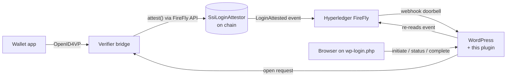

# blocLabs SSI Login

**Passwordless WordPress login with Verifiable Credentials, where every login decision is provable.**

A visitor scans a QR code with their identity wallet and presents a credential over
[OpenID for Verifiable Presentations 1.0](https://openid.net/specs/openid-4-verifiable-presentations-1_0.html).
A verifier checks it and records its decision on a blockchain through
[Hyperledger FireFly](https://hyperledger-firefly.github.io/firefly/latest/). FireFly streams that record to
WordPress, which logs the visitor in. The chain holds commitments only, never claims or identifiers.

> **Status: pre-alpha (0.1.0-dev).** The plugin framework, the attestor contract, the FireFly event path and the
> reference verifier bridge ([`bridge/`](bridge/), on walt.id verifier-api2) are built and unit-tested. A login has
> not been exercised end to end with a real wallet yet, so treat the whole as unreleased. See [Roadmap](#roadmap).



## Why

- **No passwords to steal.** The wallet proves possession of a credential bound to a key on the user's device.
- **Selective disclosure.** The site asks for what it needs (a DCQL query) and nothing more.
- **Provable logins.** Each decision is an on-chain event signed by an authorised verifier, so it can be audited
  later without trusting the web server's logs. Per-attempt blinded commitments keep one person's logins unlinkable
  on the chain.
- **Verifiable agents (planned).** Software agents can hold credentials too. The same flow is designed to let them
  prove who they are and who they act for (roadmap 0.4).

## How it works

1. The login page calls `POST /wp-json/bloclabs-ssi/v1/initiate`. WordPress opens an attempt bound to the browser
   by an HttpOnly cookie and asks the verifier bridge for a presentation request.
2. The browser shows the `openid4vp://` request as a QR code and a same-device link.
3. The wallet presents to the verifier. The verifier checks signatures, holder binding, issuer trust and
   revocation, then calls `attest(correlationId, result, subjectCommitment, presentationHash)` through FireFly.
4. FireFly's contract listener picks up `LoginAttested` and its webhook subscription notifies WordPress.
   WordPress treats the delivery as a doorbell and re-reads the event from FireFly before trusting it.
5. The browser, polling `GET /status/{attempt}`, sees `verified` and calls `POST /complete`. WordPress fetches the
   verified subject from the bridge, checks it against the on-chain commitments, maps it to a user and sets the
   auth cookie.

The full flow, with every FireFly call, is in [docs/FIREFLY-FLOW.md](docs/FIREFLY-FLOW.md).

## Documentation

| Document | What it covers |
|---|---|
| [Architecture](docs/ARCHITECTURE.md) | Components, trust boundaries, data model, extension points, deployment topologies |
| [FireFly flow](docs/FIREFLY-FLOW.md) | Setup and runtime API calls, payloads, timings measured on a real node |
| [Bridge API](docs/BRIDGE-API.md) | The contract between the plugin and any OpenID4VP verifier |
| [Bridge](bridge/README.md) | The reference bridge on walt.id verifier-api2: setup, configuration, limitations |
| [Security model](docs/SECURITY-MODEL.md) | Threats and mitigations, including the cross-device QR relay attack |
| [Decisions](docs/adr/) | Why OpenID4VP at the edge, a custom table, webhooks with a pull fallback, on-chain attestation, a dependency-free bridge |

## Requirements

- WordPress 6.6+, PHP 8.1+
- Hyperledger FireFly 1.3+ (tested on 1.5.0) with an EVM chain (tested on Besu QBFT)
- An OpenID4VP verifier behind the [bridge API](docs/BRIDGE-API.md): the reference bridge in [`bridge/`](bridge/)
  with [walt.id verifier-api2](https://github.com/walt-id/waltid-identity) 1.2.0 (Node 22 for the bridge, a JVM
  container for the verifier)
- On multisite: activate it on each site (network activation is refused), and only a network administrator
  (`manage_network_options`) can open and save the settings.

## Try it

A local demo of the whole login: WordPress, this plugin, the verifier bridge, walt.id issuer / wallet / verifier 1.2.0, and Hyperledger FireFly 1.5.0 on a Besu chain. Docker is the only dependency. On Windows, use Docker Desktop and run the commands in Git Bash.

```bash
cd demo
./setup.sh
```

The first run downloads the images, generates keys under `demo/runtime/`, `demo/signer/` and `demo/registry-owner/` (those directories are gitignored; nothing in them is committed), compiles the attestor and the trusted-issuer registry with solc 0.8.28 for the Paris EVM, deploys both, trusts the generated issuer for the member credential, installs WordPress and subscribes to FireFly. It then prints a credential offer for Ada Lovelace (`ada@example.com`) and the WordPress administrator password. The bridge is pointed at the registry (`FIREFLY_REGISTRY_API`). Its signing key can attest and is not the registry owner. Setup holds the owner key in the signer's memory only while it is trusting the issuer, so a presented credential is accepted only when that issuer and type are trusted on chain.

Only three ports are published, all on `127.0.0.1`: WordPress at <http://127.0.0.1:8080>, the wallet at <http://127.0.0.1:7106>, and the wallet API at <http://127.0.0.1:7006>. FireFly's API has no authentication of its own, so it is not published.

1. Open the wallet and register (any email, password of at least 4 characters).
2. On Receive, paste the credential offer `./setup.sh` printed. The offer lasts a day; run `./setup.sh` again for a new one.
3. Open <http://127.0.0.1:8080/wp-login.php> and choose **Log in with a digital credential**.
4. Copy the address of **Open wallet on this device**. It starts with `openid4vp://`. A desktop browser will not hand that scheme to the web wallet.
5. In the wallet, on Present, paste that address and approve.
6. The site home page greets you as Ada Lovelace. The demo creates that account from the credential (`auto_provision`); the display name is the credential's `name` claim.

The wallet picks up blocLabs orange from its image settings. WordPress in the demo also uses Barlow and Exo, pill buttons and the light panel colour. The plugin itself stays unbranded; the demo look is a must-use plugin mounted only here.

This stack is a local demo, not a deployment guide. Reset it with `docker compose down -v` and `rm -rf runtime signer registry-owner` from `demo/` (the chain data and the generated keys have to go together). Details of how the containers find each other are in [demo/README.md](demo/README.md).

## Development

```bash
composer install
composer test    # PHPUnit
composer test:integration   # WordPress integration suite (PHPUnit 9, needs MySQL)
WP_MULTISITE=1 composer test:integration   # the same suite on a multisite network
composer phpcs   # WordPress coding standards
npm install && npm run vendor   # optional: copies the QR encoder into assets/vendor/
cd bridge && npm ci && npm test  # the verifier bridge (Node 22): build and tests
```

Without PHP locally: `docker run --rm -v "$PWD:/app" -w /app composer:2 sh -c "composer install && composer test"`.

## Roadmap

- **0.1** Plugin framework, attestor contract, FireFly event path, unit tests (this release).
- **0.2** Reference verifier bridge on [walt.id verifier-api2](https://github.com/walt-id/waltid-identity)
  (built: [`bridge/`](bridge/)), and a one-command Docker demo (WordPress, FireFly, Besu, verifier) (open).
- **0.3** "Link a credential" on the profile screen; same-device login through the browser's
  [Digital Credentials API](https://www.w3.org/TR/digital-credentials/); integration tests on `wp-env`, in addition to the current CI suite.
- **0.4** On-chain trusted-issuer registry; agent login that issues an application token instead of a cookie.
- **1.0** External security review, WordPress.org listing (founder decision).

## Security

Please report vulnerabilities privately; see [SECURITY.md](SECURITY.md).

## License

GPL-2.0-or-later. See [LICENSE](LICENSE).
