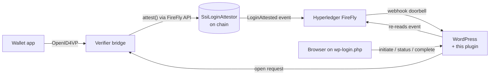

# blocLabs SSI Login

**Passwordless WordPress login with Verifiable Credentials, where every login decision is provable.**

A visitor scans a QR code with their identity wallet and presents a credential over
[OpenID for Verifiable Presentations 1.0](https://openid.net/specs/openid-4-verifiable-presentations-1_0.html).
A verifier checks it and records its decision on a blockchain through
[Hyperledger FireFly](https://hyperledger-firefly.github.io/firefly/latest/). FireFly streams that record to
WordPress, which logs the visitor in. The chain holds commitments only, never claims or identifiers.

> **Status: 0.3.0, first release (2026-11-06).** The plugin, the attestor and trusted-issuer registry contracts, the
> FireFly event path and the reference verifier bridge ([`bridge/`](bridge/), on walt.id verifier-api2) are built and
> tested, and real phone-wallet logins (Paradym on iOS, same device and cross device) have run end to end. It has not
> had an external security review yet (milestone 1.0). See [Roadmap](#roadmap).



## Why

- **No passwords to steal.** The wallet proves possession of a credential bound to a key on the user's device.
- **Selective disclosure.** The site asks for what it needs (a DCQL query) and nothing more.
- **Provable logins.** Each decision is an on-chain event signed by an authorised verifier, so it can be audited
  later without trusting the web server's logs. Per-attempt blinded commitments keep one person's logins unlinkable
  on the chain.
- **Verifiable agents (planned).** Software agents can hold credentials too. The same flow is designed to let them
  prove who they are and who they act for (roadmap 0.4).

## How it works

1. The login page calls `POST /wp-json/bloclabs-ssi/v1/initiate`. WordPress opens an attempt bound to the browser
   by an HttpOnly cookie and asks the verifier bridge for a presentation request.
2. The browser asks the wallet through the [Digital Credentials API](https://www.w3.org/TR/digital-credentials/)
   where it has it and the bridge offers that path, and otherwise shows the `openid4vp://` request as a QR code
   and a same-device link.
3. The wallet presents to the verifier. The verifier checks signatures, holder binding, issuer trust and
   revocation, then calls `attest(correlationId, result, subjectCommitment, presentationHash)` through FireFly.
4. FireFly's contract listener picks up `LoginAttested` and its webhook subscription notifies WordPress.
   WordPress treats the delivery as a doorbell and re-reads the event from FireFly before trusting it.
5. The browser, polling `GET /status/{attempt}`, sees `verified` and calls `POST /complete`. WordPress fetches the
   verified subject from the bridge, checks it against the on-chain commitments, maps it to a user and sets the
   auth cookie.

The full flow, with every FireFly call, is in [docs/FIREFLY-FLOW.md](docs/FIREFLY-FLOW.md).

## Documentation

| Document | What it covers |
|---|---|
| [Architecture](docs/ARCHITECTURE.md) | Components, trust boundaries, data model, extension points, deployment topologies |
| [FireFly flow](docs/FIREFLY-FLOW.md) | Setup and runtime API calls, payloads, timings measured on a real node |
| [Bridge API](docs/BRIDGE-API.md) | The contract between the plugin and any OpenID4VP verifier |
| [Bridge](bridge/README.md) | The reference bridge on walt.id verifier-api2: setup, configuration, limitations |
| [Security model](docs/SECURITY-MODEL.md) | Threats and mitigations, including the cross-device QR relay attack |
| [Decisions](docs/adr/) | Why OpenID4VP at the edge, a custom table, webhooks with a pull fallback, on-chain attestation, a dependency-free bridge |

## Requirements

- WordPress 6.6+, PHP 8.1+
- Hyperledger FireFly 1.3+ (tested on 1.5.0) with an EVM chain (tested on Besu QBFT)
- An OpenID4VP verifier behind the [bridge API](docs/BRIDGE-API.md): the reference bridge in [`bridge/`](bridge/)
  with [walt.id verifier-api2](https://github.com/walt-id/waltid-identity) 1.2.0 (Node 22 for the bridge, a JVM
  container for the verifier)
- On multisite: activate it on each site (network activation is refused), and only a network administrator
  (`manage_network_options`) can open and save the settings.

## Development

```bash
composer install
composer test    # PHPUnit
composer test:integration   # WordPress integration suite (PHPUnit 9, needs MySQL)
WP_MULTISITE=1 composer test:integration   # the same suite on a multisite network
composer phpcs   # WordPress coding standards
npm install && npm run vendor   # optional: copies the QR encoder into assets/vendor/
cd bridge && npm ci && npm test  # the verifier bridge (Node 22): build and tests
```

Without PHP locally: `docker run --rm -v "$PWD:/app" -w /app composer:2 sh -c "composer install && composer test"`.

## Roadmap

- **0.1** Plugin framework, attestor contract, FireFly event path, unit tests (done).
- **0.2** Reference verifier bridge on [walt.id verifier-api2](https://github.com/walt-id/waltid-identity)
  (done: [`bridge/`](bridge/)); a one-command Docker demo (WordPress, FireFly, Besu, verifier) (open).
- **0.3** (this release) "Link a credential" on the profile screen (done); same-device login through the browser's
  [Digital Credentials API](https://www.w3.org/TR/digital-credentials/) (built, off unless configured); signed
  requests for phone wallets (done); on-chain trusted-issuer registry, brought forward from 0.4 (done);
  integration tests on `wp-env` (open).
- **0.4** Agent login that issues an application token instead of a cookie
  ([ADR 0007](docs/adr/0007-agent-login.md), in progress).
- **1.0** External security review, WordPress.org listing (founder decision).

## Security

Please report vulnerabilities privately; see [SECURITY.md](SECURITY.md).

## License

GPL-2.0-or-later. See [LICENSE](LICENSE).
