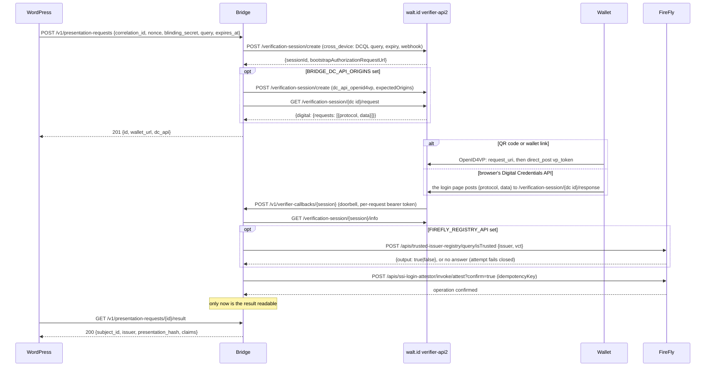

# Verifier bridge

The service between wallets, WordPress and Hyperledger FireFly: the reference implementation of
[docs/BRIDGE-API.md](../docs/BRIDGE-API.md) for the blocLabs SSI Login plugin, built on
[walt.id verifier-api2](https://github.com/walt-id/waltid-identity/tree/main/waltid-services/waltid-verifier-api2)
(OpenID4VP 1.0, DCQL). TypeScript on Node 22, no runtime dependencies
([ADR 0005](../docs/adr/0005-bridge-stack.md)).



## What it does

1. **Opens a verifier session** per login attempt: a cross-device OpenID4VP 1.0 session with the DCQL query named by
   WordPress, expiring at the attempt's `expires_at`, retained for a minute longer, and with a webhook back to the
   bridge. walt.id picks the OpenID4VP `nonce` itself; the attempt is bound by `correlation_id`, not by the nonce.
   When WordPress names a `return_url`, the session carries it as walt.id's `redirects` (success and error alike),
   so that a wallet on the same device, having posted its presentation, opens the page the attempt started on and
   the browser finishes it; the URL must be `https` (plain `http` on `localhost` only) and is never logged.
   With `BRIDGE_DC_API_ORIGINS` set it opens a second session for the same attempt, of walt.id's flow type
   `dc_api_openid4vp`, bound to the login pages' origins, and returns its request as `dc_api` (walt.id's own
   `{digital: {requests}}` wrapper from `GET …/request`) with the public response route the login page posts the
   browser's answer to. The holder answers one of the two; the first decision settles the attempt and the other
   session can no longer change it. If the second session cannot be opened and read within two seconds of the
   request arriving (WordPress waits five seconds for the whole answer, and the QR code must not be late for an
   extra), the error is logged and `dc_api` is `null`: the QR code stands alone.
2. **Treats the verifier's webhook as a doorbell.** Every session update makes the bridge re-read the session from the
   verifier; the posted body is never trusted. The callback route is authenticated with a random bearer token the
   bridge gave the verifier for that request's sessions only; each session rings under its own id.
3. **Reads the decision.** `SUCCESSFUL` means every presentation and credential policy passed (holder binding over the
   verifier's nonce and audience, issuer signature, and whatever `policies` the query adds, such as allowed issuers and
   status lists). `FAILED` is a rejection, including a wallet's OpenID4VP error response.
4. **Checks the issuer on chain** when `FIREFLY_REGISTRY_API` is set: `isTrusted(issuer, vct)` on the
   `TrustedIssuerRegistry` contract, through its FireFly API, for the presented credential's `iss` and `vct`. A pair
   the registry does not trust is attested as a rejection (`result = 2`), like a presentation walt.id refused. When
   the registry cannot answer (FireFly unreachable, the API missing, an output that is not a boolean), the attempt
   fails closed: nothing is attested and WordPress reads `failed`. A credential without `iss` or `vct` is untrusted
   without a query. Unset, the verifier's `allowed-issuer` policy is the only issuer check.
5. **Computes the commitments.** `subject_id` is the holder key the presentation was bound to: the RFC 9278 thumbprint
   URI of `cnf.jwk`, or the DID behind `cnf.kid`. `subjectCommitment = sha256(correlation_id ":" blinding_secret ":"
   subject_id)`, with the per-attempt secret WordPress sent and nobody else holds; `presentationHash = sha256(canonical
   JSON of the vp_token map)` (see BRIDGE-API.md).
6. **Attests through FireFly** with `idempotencyKey = bloclabs-ssi-login:<correlation_id>`. A retry after a timeout or
   crash can never attest twice: FireFly answers `409 FF10431` with the earlier transaction, and the bridge reads that
   transaction's status instead. Rejections are attested with `result = 2` and zero commitments.
7. **Serves the result** to WordPress only after FireFly accepted the attestation, for the attempt lifetime plus a
   minute, then deletes it. Claims are those at the DCQL claim paths the query asked for, nothing more.

Nothing personal is logged: request ids, states, FireFly operation ids and error codes only.

## Routes

| Route | Caller | Auth |
|---|---|---|
| `POST /v1/presentation-requests` | WordPress | `Authorization: Bearer <BRIDGE_AUTH_TOKEN>` |
| `GET /v1/presentation-requests/{id}/result` | WordPress | same |
| `POST /v1/verifier-callbacks/{session}` | walt.id (session webhook) | per-request bearer token |
| `GET /healthz` | container health check | none |

The WordPress routes belong on a private network: the result route returns claims, and its id appears in the QR code.
The verifier's wallet-facing endpoints (`/verification-session/{id}/request` and `/response`) are the only public
surface; with the Digital Credentials API path the login page in the visitor's browser posts to `/response` as well,
so that route must stay reachable from browsers, which walt.id 1.2.0 allows for every origin in its CORS settings.
Its management endpoints (`/create`, `/info`) must not be reachable from the internet either, because walt.id does
not authenticate callers.

## Configuration

Environment variables only.

| Variable | Required | Meaning |
|---|---|---|
| `BRIDGE_AUTH_TOKEN` | yes | At least 32 characters. WordPress sends `Authorization: Bearer <token>` (plugin setting `verifier_auth_header`, best pinned as `BLOCLABS_SSI_VERIFIER_AUTH_HEADER`). The bridge refuses to start without it. |
| `BRIDGE_CALLBACK_URL` | yes | The bridge's callback route as the verifier reaches it, e.g. `http://bridge:8090/v1/verifier-callbacks`. The request id is appended. |
| `VERIFIER_URL` | yes | walt.id verifier-api2 base URL as the bridge reaches it, e.g. `http://verifier:7004`. |
| `VERIFIER_SIGNED_REQUEST` | no | `true` asks walt.id for signed requests; default `false`. Requires the verifier client id, key and certificate configuration below. Invalid booleans fail startup. |
| `FIREFLY_URL` | yes | FireFly core, e.g. `http://firefly_core:5000`. |
| `FIREFLY_NAMESPACE` | no | Default `default`. |
| `FIREFLY_API_NAME` | no | The contract API name, default `ssi-login-attestor`. |
| `FIREFLY_SIGNING_KEY` | yes | The address FireFly signs `attest` with; the contract owner must have authorised it. |
| `FIREFLY_AUTH_HEADER` | no | `Authorization` header for an authenticating proxy in front of FireFly. Sent on the registry query too. |
| `FIREFLY_REGISTRY_API` | no | The FireFly API name of the `TrustedIssuerRegistry` contract (`trusted-issuer-registry` in docs/FIREFLY-FLOW.md), in the same namespace. When set, every presented credential's `(iss, vct)` must be trusted on chain (step 4 above); the attempt fails closed when the registry cannot answer. Unset: no on-chain check. |
| `BRIDGE_QUERIES` | yes | JSON object of named queries (below). Must contain `default`. |
| `BRIDGE_DC_API_ORIGINS` | no | Turns on the Digital Credentials API path: the origins of the login pages (`https://site.example`, with the port if any; one per site, separated by commas or whitespace), as the browser reports them to the wallet. Scheme, host and port only, and a secure context: `https`, or `http` on localhost for a test stack. Unset, every `dc_api` is `null`. |
| `VERIFIER_PUBLIC_URL` | with the above | walt.id verifier-api2 base URL as browsers reach it, e.g. `https://<verifier-public-host>`: the login page posts the browser's answer to `<VERIFIER_PUBLIC_URL>/verification-session/{id}/response`. Must be `https` when the site is. |
| `BRIDGE_PORT` | no | Default `8090`. |
| `BRIDGE_LISTEN_HOST` | no | Default `0.0.0.0`. |
| `BRIDGE_LOG_LEVEL` | no | `debug`, `info` (default), `warn`, `error`. |

### Queries

Each entry of `BRIDGE_QUERIES` is passed to walt.id as the session's `dcql_query` and optional `policies`
(`vp_policies`, `vc_policies`, `specific_vc_policies`, in walt.id's JSON). The bridge checks at start-up that every
credential query uses the `dc+sd-jwt` format and keeps cryptographic holder binding, because the subject it reports
is the bound holder key. It also refuses a query that could make the wallet present more than one credential,
because the subject and the claims are read from exactly one: list a single credential query, or list several and
add one required `credential_sets` entry whose options each name one of them (the wallet then presents one of
those); `multiple: true` is refused. Without `policies`, walt.id runs its defaults: KB-JWT signature, nonce,
audience and `sd_hash` checks on the presentation, and the issuer signature on the credential. Add
`allowed-issuer` and `credential-status` policies to pin the trusted issuers and check revocation (with
`FIREFLY_REGISTRY_API` set, the on-chain registry is checked as well, so an issuer must pass both):

```json
{
  "default": {
    "dcql_query": {
      "credentials": [{
        "id": "login",
        "format": "dc+sd-jwt",
        "meta": {"vct_values": ["https://issuer.example.com/credentials/employee"]},
        "claims": [{"path": ["given_name"]}, {"path": ["email"]}]
      }]
    },
    "policies": {
      "vc_policies": [
        "signature", "expiration", "not-before",
        {"policy": "allowed-issuer", "allowed_issuer": ["did:web:issuer.example.com"]},
        {"policy": "credential-status", "argument": {"value": 0}}
      ]
    }
  }
}
```

`claims` decides what the wallet is asked to disclose and what `claims` in the result contains. A credential query
without `claims` asks for the whole credential and returns every disclosed claim except the registered ones
(`iss`, `iat`, `nbf`, `exp`, `cnf`, `vct`, `status`).

## Running

```bash
cd bridge
npm ci
npm test          # builds, then runs the tests against the compiled output
export BRIDGE_AUTH_TOKEN="$(openssl rand -base64 32)" BRIDGE_CALLBACK_URL=... VERIFIER_URL=... FIREFLY_URL=... FIREFLY_SIGNING_KEY=... BRIDGE_QUERIES='{...}'
npm start
```

With Docker: `docker build -t bloclabs-ssi-bridge .`, or copy [`docker-compose.example.yml`](docker-compose.example.yml)
and the [`verifier/`](verifier/) configuration, replace every placeholder, and `docker compose up`. The compose file pins
`waltid/verifier-api2:1.2.0`, the release the bridge was written against (its session API was also checked against
walt.id `main` on 2026-11-03).

### walt.id configuration

- `verifier/verifier-service.conf`: `urlPrefix` is the public base of the wallet-facing endpoints
  (`https://<verifier-public-host>/verification-session`), `urlHost` the scheme of the authorization request URL
  (`openid4vp://authorize`). Unsigned requests omit `clientId`, `key` and `x5c` and leave
  `VERIFIER_SIGNED_REQUEST=false`. Signed mode is described below.
- Session updates go to `BRIDGE_CALLBACK_URL`, a private address. walt.id versions after 1.2.0 refuse webhooks to
  private networks unless `config/network-fetch-guard.conf` sets `allowPrivateNetworks = true`; the example ships that
  file so an upgrade keeps working.
- The bridge sets `expiration_date` (no wallet responses after the attempt's `expires_at`) and `retention_date`
  (walt.id discards the session, with the presented credential, a minute later).
- The same-device return needs no verifier configuration: with `redirects` on the session, walt.id 1.2.0 answers the
  wallet's `direct_post` with `redirect_uri`, the URL plus its own `response_code`, which WordPress ignores.

### Signed requests for phone wallets

Production wallets may refuse unsigned requests. Set `VERIFIER_SIGNED_REQUEST=true` on the bridge **and**
configure the verifier's certified identity: walt.id 1.2.0 requires `core_flow.signed_request=true` for each
session; a configured key alone does not turn signing on. The bridge sends that flag when enabled and
keeps private signing material in the verifier. Misconfigured signed sessions fail; the bridge does not
retry them unsigned.

Use `x509_san_dns` for a DNS identity. The client id is `x509_san_dns:<hostname>` and the leaf certificate
must have that exact hostname as a DNS subject alternative name (SAN). `x509_hash` instead uses
`x509_hash:<base64url-without-padding(SHA-256(leaf-certificate-DER))>`. It identifies a certificate rather
than asserting a DNS identity; check wallet support and trust requirements before choosing it. Both use
an ES256/P-256 signing key and an `x5c` chain of standard base64 DER certificates, leaf first.

For a **local smoke test**, generate a fresh self-signed certificate (Node 22 and OpenSSL required).
Run from `bridge/`; replace `verifier.example.com` with the wallet-facing HTTPS hostname for your stack:

```bash
umask 077
mkdir -p verifier/private
openssl req -x509 -newkey ec -pkeyopt ec_paramgen_curve:P-256 -nodes \
  -keyout verifier/private/request-key.pem -out verifier/private/request-cert.pem \
  -days 7 -subj '/CN=verifier.example.com' \
  -addext 'subjectAltName=DNS:verifier.example.com' \
  -addext 'keyUsage=critical,digitalSignature' \
  -addext 'basicConstraints=critical,CA:FALSE'
node verifier/configure-signing.mjs \
  --key verifier/private/request-key.pem --cert verifier/private/request-cert.pem \
  --url https://verifier.example.com --mode x509_san_dns \
  --name 'Example credential login' --output verifier/private/verifier-service.conf
```

For `x509_hash`, use the same command with `--mode x509_hash` and a fresh output path. The helper derives
the identifier from the leaf certificate, converts the private key to walt.id's JWK configuration, and checks
key/certificate matching, certificate dates, chain order and the DNS SAN in DNS mode. It writes a new
mode-0600 file and refuses to overwrite an existing one. The output is JSON (valid HOCON), contains a
private key, and must stay private; `verifier/private/` is ignored by git. Do not paste its contents into logs
or issues. Keep the original PEM key private too.

In `docker-compose.example.yml`, enable the commented single-file mount over `verifier-service.conf` and
set `VERIFIER_SIGNED_REQUEST: "true"`. Recreate the verifier and bridge. Ensure the verifier container user
can read the private file without making it world-readable. Preserve the other config files and any local
customizations (the helper generates only `verifier-service.conf`). Expose only the verifier's `/request` and
`/response` endpoints through your HTTPS proxy, as described above.

For production phone testing, use a certificate chain accepted by the wallet, issued for the correct DNS SAN,
with the corresponding P-256 private key. Supply the leaf and intermediates as a leaf-first PEM bundle to
`--cert`. A self-signed certificate proves signing works in the smoke test; it does **not** establish that
Paradym on iPhone trusts the verifier. The public HTTPS endpoint also needs a TLS certificate trusted by the
phone. Request-signing and HTTPS certificates serve separate purposes. Confirm Paradym's verifier certificate
and client-id requirements during Britney's phone test.

The live regression test starts the pinned walt.id image locally with fresh self-signed material, creates
sessions through the bridge's session builder, fetches the wallet request, and verifies the ES256 signature,
`x5c`, client id, response URI, nonce and DCQL. It also checks unchanged unsigned `redirect_uri` behavior:

```bash
npm ci
npm test
npm run build && node verifier/test-signed-requests.mjs
```

The last command needs the local Docker daemon, access to `waltid/verifier-api2:1.2.0`, and OpenSSL. It binds
random ports to loopback, uses temporary keys/configuration, and removes its containers and files afterwards.
It does not exercise a phone presentation, FireFly or WordPress.

## Limitations (0.2)

- State is in memory. A restart loses open requests; their login attempts expire in WordPress and the visitor starts
  again. Results are gone after the attempt lifetime plus a minute in any case.
- SD-JWT VC (`dc+sd-jwt`) only. mdoc needs a different holder identifier (the device key) and is not implemented.
- The verifier's webhook is the only trigger. walt.id does not retry a failed webhook, so if the bridge is down at
  that moment the attempt expires. Several updates are posted per session, so a single lost delivery is usually
  caught by the next one.
- The Digital Credentials API path is off unless `BRIDGE_DC_API_ORIGINS` is set. walt.id then builds the request
  unsigned with the answer in clear (`response_mode: dc_api`) unless its own configuration signs or encrypts; the
  bridge does not choose. It also costs a second verifier session, and two more verifier calls, per login attempt.
- Returning the holder to the browser after a same-device presentation depends on the wallet honouring the
  `redirect_uri` in the verifier's answer to its `direct_post` (OpenID4VP 1.0 §8.2). A wallet that ignores it leaves
  the holder in the wallet; the page the attempt started on finishes it when the holder switches back by hand,
  as long as the attempt has not expired.
