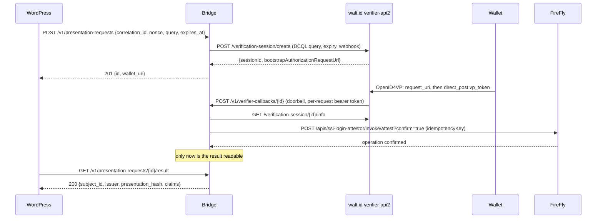

# Verifier bridge

The service between wallets, WordPress and Hyperledger FireFly: the reference implementation of
[docs/BRIDGE-API.md](../docs/BRIDGE-API.md) for the blocLabs SSI Login plugin, built on
[walt.id verifier-api2](https://github.com/walt-id/waltid-identity/tree/main/waltid-services/waltid-verifier-api2)
(OpenID4VP 1.0, DCQL). TypeScript on Node 22, no runtime dependencies
([ADR 0005](../docs/adr/0005-bridge-stack.md)).



## What it does

1. **Opens a verifier session** per login attempt: a cross-device OpenID4VP 1.0 session with the DCQL query named by
   WordPress, expiring at the attempt's `expires_at`, retained for a minute longer, and with a webhook back to the
   bridge. walt.id picks the OpenID4VP `nonce` itself; the attempt is bound by `correlation_id`, not by the nonce.
2. **Treats the verifier's webhook as a doorbell.** Every session update makes the bridge re-read the session from the
   verifier; the posted body is never trusted. The callback route is authenticated with a random bearer token the
   bridge gave the verifier for that session only.
3. **Reads the decision.** `SUCCESSFUL` means every presentation and credential policy passed (holder binding over the
   verifier's nonce and audience, issuer signature, and whatever `policies` the query adds, such as allowed issuers and
   status lists). `FAILED` is a rejection, including a wallet's OpenID4VP error response.
4. **Computes the commitments.** `subject_id` is the holder key the presentation was bound to: the RFC 9278 thumbprint
   URI of `cnf.jwk`, or the DID behind `cnf.kid`. `subjectCommitment = sha256(correlation_id ":" subject_id)`;
   `presentationHash = sha256(canonical JSON of the vp_token map)` (see BRIDGE-API.md).
5. **Attests through FireFly** with `idempotencyKey = bloclabs-ssi-login:<correlation_id>`. A retry after a timeout or
   crash can never attest twice: FireFly answers `409 FF10431` with the earlier transaction, and the bridge reads that
   transaction's status instead. Rejections are attested with `result = 2` and zero commitments.
6. **Serves the result** to WordPress only after FireFly accepted the attestation, for the attempt lifetime plus a
   minute, then deletes it. Claims are those at the DCQL claim paths the query asked for, nothing more.

Nothing personal is logged: request ids, states, FireFly operation ids and error codes only.

## Routes

| Route | Caller | Auth |
|---|---|---|
| `POST /v1/presentation-requests` | WordPress | `Authorization: Bearer <BRIDGE_AUTH_TOKEN>` |
| `GET /v1/presentation-requests/{id}/result` | WordPress | same |
| `POST /v1/verifier-callbacks/{id}` | walt.id (session webhook) | per-session bearer token |
| `GET /healthz` | container health check | none |

The WordPress routes belong on a private network: the result route returns claims, and its id appears in the QR code.
The verifier's wallet-facing endpoints (`/verification-session/{id}/request` and `/response`) are the only public
surface; its management endpoints (`/create`, `/info`) must not be reachable from the internet either, because walt.id
does not authenticate callers.

## Configuration

Environment variables only.

| Variable | Required | Meaning |
|---|---|---|
| `BRIDGE_AUTH_TOKEN` | yes | At least 32 characters. WordPress sends `Authorization: Bearer <token>` (plugin setting `verifier_auth_header`, best pinned as `BLOCLABS_SSI_VERIFIER_AUTH_HEADER`). The bridge refuses to start without it. |
| `BRIDGE_CALLBACK_URL` | yes | The bridge's callback route as the verifier reaches it, e.g. `http://bridge:8090/v1/verifier-callbacks`. The request id is appended. |
| `VERIFIER_URL` | yes | walt.id verifier-api2 base URL as the bridge reaches it, e.g. `http://verifier:7004`. |
| `FIREFLY_URL` | yes | FireFly core, e.g. `http://firefly_core:5000`. |
| `FIREFLY_NAMESPACE` | no | Default `default`. |
| `FIREFLY_API_NAME` | no | The contract API name, default `ssi-login-attestor`. |
| `FIREFLY_SIGNING_KEY` | yes | The address FireFly signs `attest` with; the contract owner must have authorised it. |
| `FIREFLY_AUTH_HEADER` | no | `Authorization` header for an authenticating proxy in front of FireFly. |
| `BRIDGE_QUERIES` | yes | JSON object of named queries (below). Must contain `default`. |
| `BRIDGE_PORT` | no | Default `8090`. |
| `BRIDGE_LISTEN_HOST` | no | Default `0.0.0.0`. |
| `BRIDGE_LOG_LEVEL` | no | `debug`, `info` (default), `warn`, `error`. |

### Queries

Each entry of `BRIDGE_QUERIES` is passed to walt.id as the session's `dcql_query` and optional `policies`
(`vp_policies`, `vc_policies`, `specific_vc_policies`, in walt.id's JSON). The bridge checks at start-up that every
credential query uses the `dc+sd-jwt` format and keeps cryptographic holder binding, because the subject it reports
is the bound holder key. Without `policies`, walt.id runs its defaults: KB-JWT signature, nonce, audience and
`sd_hash` checks on the presentation, and the issuer signature on the credential. Add `allowed-issuer` and
`credential-status` policies to pin the trusted issuers and check revocation:

```json
{
  "default": {
    "dcql_query": {
      "credentials": [{
        "id": "login",
        "format": "dc+sd-jwt",
        "meta": {"vct_values": ["https://issuer.example.com/credentials/employee"]},
        "claims": [{"path": ["given_name"]}, {"path": ["email"]}]
      }]
    },
    "policies": {
      "vc_policies": [
        "signature", "expiration", "not-before",
        {"policy": "allowed-issuer", "allowed_issuer": ["did:web:issuer.example.com"]},
        {"policy": "credential-status", "argument": {"value": 0}}
      ]
    }
  }
}
```

`claims` decides what the wallet is asked to disclose and what `claims` in the result contains. A credential query
without `claims` asks for the whole credential and returns every disclosed claim except the registered ones
(`iss`, `iat`, `nbf`, `exp`, `cnf`, `vct`, `status`).

## Running

```bash
cd bridge
npm ci
npm test          # builds, then runs the tests against the compiled output
export BRIDGE_AUTH_TOKEN="$(openssl rand -base64 32)" BRIDGE_CALLBACK_URL=... VERIFIER_URL=... FIREFLY_URL=... FIREFLY_SIGNING_KEY=... BRIDGE_QUERIES='{...}'
npm start
```

With Docker: `docker build -t bloclabs-ssi-bridge .`, or copy [`docker-compose.example.yml`](docker-compose.example.yml)
and the [`verifier/`](verifier/) configuration, replace every placeholder, and `docker compose up`. The compose file pins
`waltid/verifier-api2:1.2.0`, the release the bridge was written against (its session API was also checked against
walt.id `main` on 2026-11-03).

### walt.id configuration

- `verifier/verifier-service.conf`: `urlPrefix` is the public base of the wallet-facing endpoints
  (`https://<verifier-public-host>/verification-session`), `urlHost` the scheme of the authorization request URL
  (`openid4vp://authorize`). Unsigned requests need no key; for signed requests with an `x509_san_dns:` client id,
  set `clientId`, `key` and `x5c` as walt.id documents.
- Session updates go to `BRIDGE_CALLBACK_URL`, a private address. walt.id versions after 1.2.0 refuse webhooks to
  private networks unless `config/network-fetch-guard.conf` sets `allowPrivateNetworks = true`; the example ships that
  file so an upgrade keeps working.
- The bridge sets `expiration_date` (no wallet responses after the attempt's `expires_at`) and `retention_date`
  (walt.id discards the session, with the presented credential, a minute later).

## Limitations (0.2)

- State is in memory. A restart loses open requests; their login attempts expire in WordPress and the visitor starts
  again. Results are gone after the attempt lifetime plus a minute in any case.
- SD-JWT VC (`dc+sd-jwt`) only. mdoc needs a different holder identifier (the device key) and is not implemented.
- The verifier's webhook is the only trigger. walt.id does not retry a failed webhook, so if the bridge is down at
  that moment the attempt expires. Several updates are posted per session, so a single lost delivery is usually
  caught by the next one.
- The Digital Credentials API path (`dc_api` in the response) is not implemented; it is always `null`.
