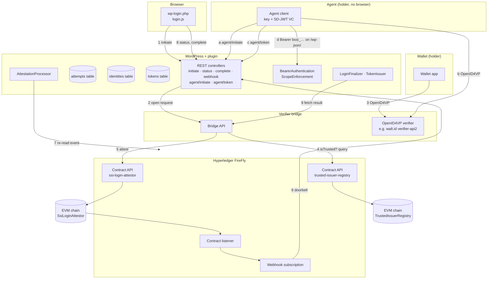

# Architecture

## Goals and non-goals

**Goals**
- Log a WordPress user in with a Verifiable Credential presented from a wallet, over a standard protocol.
- Let a software agent log in the same way, with no browser, and get a scoped, short-lived application token
  instead of a cookie ([ADR 0007](adr/0007-agent-login.md)).
- Make every login decision provable after the fact, without putting personal data on a ledger.
- Keep WordPress light: no credential parsing, no cryptographic keys, no long-running processes in PHP.
- Stay adaptable: the verifier, the event decoder and the user mapping are swappable.

**Non-goals**
- Being a wallet or an issuer.
- Replacing WordPress's password login. The credential block sits next to the password form.
- Requiring a blockchain for the protocol itself. The chain is the audit and event backbone and, with the
  trusted-issuer registry, the place where issuer trust is governed. It is not the cryptographic trust root of the
  credential: a credential's signature is checked against the issuer's own key, off chain.

## Components

A browser login runs 1–9 and ends with an auth cookie. An agent login runs 1–7 under other names (a–c): the agent
opens the attempt itself, presents the credential from its own key, polls the token route until the chain has
spoken, and receives a token once. It then calls the REST API with that token (d), which `BearerAuthentication`
checks on every request and `ScopeEnforcement` confines to the token's scope.

| Layer | Component | Responsibility |
|---|---|---|
| Frontend | `LoginScreen`, `AssetManager`, `assets/js/login.js` | Injects the credential block on `wp-login.php`, renders the QR code and same-device link, polls, completes |
| Auth | `Rest\*Controller`, `BrowserBinding`, `HeaderBinding`, `LoginChecks`, `LoginFinalizer`, `TokenIssuer` | Nonced, cookie-bound browser endpoints and header-bound agent endpoints; the checks both logins share (the chain against the bridge's answer, the user against the login filters); programmatic login with `wp_set_current_user()` and `wp_set_auth_cookie()`, or an application token returned once |
| Bearer | `Auth\BearerAuthentication`, `Auth\ScopeEnforcement`, `Login\Scope` | Authenticates `/wp-json/` requests that carry an application token, in REST only; confines them to the token's scope through `map_meta_cap` and `user_has_cap` |
| Session | `AttemptRepository`, `AttemptStatus` | Short-lived attempts in their own table, compare-and-set status changes |
| Identity | `IdentityRepository`, `UserResolver`, `AgentCredential`, `AgentDelegation` | Maps a verified subject to a user: link-only by default, optional provisioning for people, never for agents; reads the agent credential (`acts_for`, `scope`, `agent.name`, `operator`) and the principal's opt-in |
| Orchestration | `FireFlyClient`, `AttestationProcessor`, `EventReconciler`, `ContractEventDecoder` | Consumes FireFly events (push, with a pull fallback), confirms them, applies them |
| Verification | `VerifierClient` (`BridgeClient`) | Asks the sidecar to open a request and, later, for the verified subject |
| Chain | `contracts/SsiLoginAttestor.sol`, `contracts/TrustedIssuerRegistry.sol` | Append-only `LoginAttested` events from authorised verifiers; the owner-governed list of trusted `(issuer, vct)` pairs that the bridge queries through FireFly before it attests |

## Where each decision lives

| Question | Answer | Record |
|---|---|---|
| Which protocol faces the wallet? | OpenID4VP 1.0, in the verifier sidecar, not in WordPress and not in FireFly | [ADR 0001](adr/0001-oid4vp-at-the-edge.md) |
| Where does transient login state live? | A custom indexed table, with an HttpOnly binding cookie | [ADR 0002](adr/0002-session-binding-custom-table.md) |
| How does WordPress hear about results? | FireFly webhook as a doorbell, re-read from FireFly, with polling as a fallback | [ADR 0003](adr/0003-event-consumption.md) |
| What does FireFly carry? | An on-chain `LoginAttested` event with commitments only | [ADR 0004](adr/0004-on-chain-attestation.md) |
| What is the bridge built with? | TypeScript on Node 22 with no runtime dependencies, next to walt.id verifier-api2 in its own container | [ADR 0005](adr/0005-bridge-stack.md) |
| Which issuers are trusted, for which credential types? | An owner-governed registry contract of `(issuer, vct)` pairs, read by the bridge through FireFly's query API before it attests; signatures, holder binding and revocation stay in the verifier | [ADR 0006](adr/0006-trusted-issuer-registry.md) |
| How does a software agent log in? | The same credential flow with no browser, bound to the agent by a header instead of a cookie; an opaque, scoped, short-lived bearer token instead of a cookie; the agent's own key linked to an account, or an `acts_for` claim from a trusted issuer plus the principal's opt-in; the on-chain attestation unchanged | [ADR 0007](adr/0007-agent-login.md) |

## Data model

**Attempt** (`{prefix}bloclabs_ssi_attempts`), one row per login try, deleted after a day:

| Column | Purpose |
|---|---|
| `public_id` | 128-bit handle the browser uses. Useless without the binding cookie |
| `correlation_id` | 256-bit id shared with the verifier and emitted on chain. Never sent to the browser |
| `binding_hash` | SHA-256 of the browser's cookie secret |
| `nonce` | Offered to the verifier for the presentation's key binding |
| `blinding_secret` | 256-bit per-attempt secret shared with the bridge only. Blinds `subject_commitment`, so the chain cannot be searched for a holder. Never sent to the browser |
| `status` | `pending` → `verified` → `consumed`, or `rejected` / `expired` / `failed` |
| `kind` | `browser` or `agent`: which route family opened the attempt and may finish it (threat A5) |
| `requested_scope` | For an agent attempt, the scope names it asked for at initiate; the token gets their intersection with the credential's and the site's |
| `verifier_ref` | The bridge's request id |
| `subject_commitment`, `presentation_hash` | Copied from the on-chain event; checked against the bridge's answer at completion |
| `firefly_event_id`, `tx_ref` | Audit trail back to FireFly and the chain |
| `ip_hash` | Keyed hash of the client (IPv4 address or IPv6 /64), for rate limiting only |

**Token** (`{prefix}bloclabs_ssi_tokens`), one row per application token ([ADR 0007 §4](adr/0007-agent-login.md)),
kept 30 days past expiry or revocation (`bloclabs_ssi_token_retention`) for the audit trail:

| Column | Purpose |
|---|---|
| `token_hash` | SHA-256 of the token, unique key. The token itself (`bssi_` and 43 base64url characters) is returned once and stored nowhere |
| `user_id`, `delegated` | The account the token acts as, and whether `acts_for` named it (1) or the agent's own key is linked to it (0) |
| `agent_subject_hash`, `agent_label`, `issuer` | The agent: HMAC of its subject id under the subject key, a label for people from the credential's `agent.name` and `operator` (or a keyed fingerprint), and the credential's issuer |
| `scope` | JSON list of scope names |
| `correlation_id`, `tx_ref`, `firefly_event_id` | Copied from the attempt: the on-chain decision this token came from, kept here because attempt rows are purged after a day |
| `created_at`, `expires_at`, `last_used_at`, `revoked_at` | Lifecycle. `last_used_at` is written at most once a minute. No addresses are stored |

**Identity** (`{prefix}bloclabs_ssi_identities`): `subject_hash` = HMAC-SHA256(plugin key, subject id) → `user_id`,
plus a short display label and the issuer DID, retained for the life of the link/account. The key is the plugin's own (`bloclabs_ssi_subject_key`, or
`BLOCLABS_SSI_SUBJECT_KEY`), so rotating WordPress salts does not unlink every credential.

Under `auto_provision`, the sanitized `name` claim becomes the new WordPress account's `display_name`; without one, `given_name` and `family_name` do (joined, or the login when neither is disclosed), and those two also become the account's first and last name. These persist with that account. Other claims are fetched from the bridge at completion and dropped unless an extension stores them. Attempt rows are purged separately; their retention does not remove account or identity data.

## Routes

All under `/wp-json/bloclabs-ssi/v1/`. The browser's carry the login-page token and the binding cookie; the agent's
exist only while `agent_login_enabled` is on and carry the attempt secret in a header instead.

| Route | Who | Carries | Answers |
|---|---|---|---|
| `POST /initiate` | browser | `redirect_to`, the page token | `201` attempt id, wallet URL (and `dc_api` where the bridge offers it), sets the binding cookie |
| `GET /status/{attempt}` | browser | the cookie | `pending`, `verified`, `rejected`, `expired`, `failed` |
| `POST /complete` | browser | the attempt, the cookie | sets the auth cookie, `redirect_to` |
| `POST /firefly/events` | FireFly | the webhook secret header | re-reads the event; always 2xx for a known shape |
| `POST /agent/initiate` | agent | `{"scope": ["read", "content"]}` (default `["read"]`) | `201 {attempt, attempt_secret, wallet_url, expires_in, poll_after}` |
| `POST /agent/token` | agent | `{"attempt"}` and `X-Bloclabs-Ssi-Attempt: <attempt_secret>` | `409 pending` with `poll_after` until the chain has spoken; then, once, `200 {token, token_type, expires_at, scope, user_id, delegated}`; afterwards `409 already used`; `503` while the verifier is unreachable |
| `DELETE /agent/token` | agent | `Authorization: Bearer <token>` | revokes that token |

The attempt routes answer 404 for an unknown attempt, for one bound to another browser or agent, and across the two
families: a browser attempt cannot become a token, nor an agent attempt a cookie.

## Trust boundaries

1. **Browser ↔ WordPress.** Public. Every browser call carries the login page nonce (a cross-site check) and the
   binding cookie (`__Host-`, HttpOnly, SameSite=Strict). Unknown and foreign attempts both answer 404.
2. **FireFly → WordPress.** The webhook is authenticated by a shared secret header (FireFly cannot sign webhooks)
   and optionally an IP allowlist. Its body is never trusted: the processor re-reads the event by id.
3. **WordPress → FireFly, WordPress → bridge.** Private network. FireFly core has no authentication of its own, so it
   must never be exposed publicly. An authenticating proxy is supported through an `Authorization` header setting.
4. **Bridge → chain.** Only addresses the contract owner authorised can emit `LoginAttested`. The contract listener
   is bound to the contract address, and the decoder independently checks the configured listener and `attestor_address` against the log emitter.
   With `FIREFLY_REGISTRY_API` set, the bridge also reads `TrustedIssuerRegistry.isTrusted(issuer, vct)` through
   FireFly's query API before it attests, and attests a rejection for an untrusted pair. The read is an `eth_call`,
   not a transaction. Only the registry's owner, an operator key that is never the bridge's signing key, can change
   the list, and every change is an `IssuerSet` event ([ADR 0006](adr/0006-trusted-issuer-registry.md)).
5. **Agent ↔ WordPress.** Public, like the browser's boundary, but with no cookie and no nonce: the attempt is bound
   to the agent by the 256-bit attempt secret in a header, and after issuance every request carries the token in the
   `Authorization` header and nothing else. The token is checked in REST only, at `rest_authentication_errors`, so
   wp-admin, `wp-login.php`, `admin-ajax.php` and XML-RPC never see its user; a refused token answers 401 and never
   falls back to a cookie or to anonymous. Over plain HTTP a token is refused unless the environment is `local`.
   What the token may do is the intersection of its scope, the credential's scope and the account's capabilities, read
   again on every request.
6. **Bridge's HTTP answer vs. its on-chain record.** At completion WordPress recomputes
   `sha256(correlation_id ":" blinding_secret ":" subject_id)` and compares the presentation hash. This binds the subject and presentation hash only. WordPress does not recompute that hash from the HTTP claims: the issuer and disclosed claims passed to hooks are unattested HTTP data. Extensions must trust the authenticated bridge for those fields, and must not treat them as separately proven on chain. With the registry on, what the chain proves about the issuer is only this: a `LoginAttested` with `result = 1` was emitted after the bridge found the credential's `(issuer, vct)` trusted; the issuer string itself is not on chain.

See [SECURITY-MODEL.md](SECURITY-MODEL.md) for threats and mitigations.

## Extension points

| Hook | Kind | Use |
|---|---|---|
| `bloclabs_ssi_verifier_client` | filter | Replace the bridge client with another `VerifierClient` |
| `bloclabs_ssi_event_decoder` | filter | Decode a different contract event or layout |
| `bloclabs_ssi_resolve_user` | filter | Last word on which user a subject becomes; an account provisioned for a login it refuses or redirects is removed again |
| `bloclabs_ssi_provision_user_data` | filter | Shape (or refuse) accounts created for new subjects |
| `bloclabs_ssi_allow_login` | filter | Veto a login after the credential checked out; anything but `true` refuses. Runs for agents too, before a token is issued |
| `bloclabs_ssi_agent_scopes` | filter | A site's own scope names and their capability sets, next to `read` and `content`; the result is checked against the denylist |
| `bloclabs_ssi_agent_token` | filter | Last word before an agent token is issued: narrow the scope or the lifetime, or refuse |
| `bloclabs_ssi_agent_token_requires_https` | filter | Whether a token is refused over plain HTTP (default: unless `wp_get_environment_type()` is `local`) |
| `bloclabs_ssi_token_retention` | filter | Seconds to keep expired and revoked token rows (default 30 days) |
| `bloclabs_ssi_wallet_url_schemes` | filter | Allowed wallet URL schemes (default `openid4vp`, `https`) |
| `bloclabs_ssi_attempt_retention` | filter | Seconds to retain attempt rows (default one day); does not govern identity/account data |
| `bloclabs_ssi_client_ip` | filter | Visitor IP behind unusual proxies |
| `bloclabs_ssi_login_template` | filter | Replace the login block markup |
| `bloclabs_ssi_attested` | action | An attestation settled an attempt |
| `bloclabs_ssi_agent_token_issued` | action | A token was issued: its row, the user, the verifier's result and the attempt |
| `bloclabs_ssi_agent_token_refused` | action | A presented token was refused, with the reason (`unknown`, `expired`, `revoked`, `no_user`, `vetoed`, `not_https`) and its hash: for lockout plugins |
| `bloclabs_ssi_agent_token_revoked` | action | A token was revoked, by whom and why |
| `bloclabs_ssi_commitment_mismatch` | action | The bridge's answer contradicted the chain: alert on this |
| `bloclabs_ssi_undecodable_event` | action | An event from the attestor listener did not decode: contract and decoder disagree |
| `bloclabs_ssi_booted` | action | Add-ons get the composition root |

Every setting can be pinned in `wp-config.php` as `BLOCLABS_SSI_<KEY>`. Secrets (`WEBHOOK_SECRET`,
`FIREFLY_AUTH_HEADER`, `VERIFIER_AUTH_HEADER` and `SUBJECT_KEY`) should only be set that way. The settings option is
created with autoload off. `VERIFIER_AUTH_HEADER` is required: without it credential login stays unavailable.

Agent login has its own settings, all off or at their defaults until a site turns it on: `AGENT_LOGIN_ENABLED`
(registers the agent routes and the bearer filters), `AGENT_CREDENTIAL_QUERY` (the bridge query for agent attempts,
default `agent`), `AGENT_TOKEN_TTL` (seconds, 300–86400, default 3600) and `AGENT_SCOPES` (the scope names the site
allows at all, default `read,content`). Per user, *Agents may act for this account* on the profile screen, off by
default, is what a delegated token needs.

## Deployment topologies

**A. Everything on one private network (recommended).** WordPress, FireFly and the bridge share a Docker network.
FireFly delivers webhooks to WordPress's internal address (`wp bloclabs-ssi subscribe --webhook-url=http://wordpress/...`),
and the webhook IP allowlist is that network's range. Only WordPress and the bridge's wallet-facing endpoints are
public.

**B. WordPress hosted elsewhere.** FireFly cannot reach WordPress. Set event delivery to *Polling only*: the status
endpoint asks FireFly for recent `LoginAttested` events, through one shared scan at a time, with a 3-second cooldown and a 30-second cooldown after transport failures. Each attempt is checked at most once every 15 seconds. WordPress still
needs to reach FireFly, through a VPN or an authenticating proxy.

**C. Long-lived listener.** A WP-CLI process holding a FireFly WebSocket was considered and deferred
([ADR 0003](adr/0003-event-consumption.md)). The event processor is shared, so it can be added later without
touching the rest.

## Verifiable agents

The flow does not assume a human, and since [ADR 0007](adr/0007-agent-login.md) it does not assume a browser. An
agent is a holder with a key and an SD-JWT VC from an issuer the registry trusts. Its credential says what the agent
is (`agent.name`, `agent.operator`), what it may ask for (`scope`) and, optionally, whom it acts for (`acts_for`, the
principal's subject id). It logs in by the routes above and gets a token instead of a cookie; the chain records the
agent's own key as the committed subject, so the attestation trail shows which agent logged in where, and the token
row keeps the correlation id, so every token traces to one on-chain decision.

The reference client is [`demo/agent/`](../demo/agent/): Node 22 with no dependencies, as the bridge. It receives
the credential over OpenID4VCI, keeps its key and credential under `AGENT_HOME`, presents over OpenID4VP with a
key-binding JWT to the request its own initiate returned and to no other, polls for the token, calls the REST API
with it and revokes it. [`demo/agent.sh`](../demo/agent.sh) runs the whole login on the demo stack.

What is still ahead: links to emerging agent-identity work.
[ERC-8004](https://eips.ethereum.org/EIPS/eip-8004) (Draft) lets an agent's registration list a DID. The DIF
Trusted AI Agents WG, the W3C Agent Identity Registry CG and the OpenID AIIM CG are working in the same direction;
none has a protocol to adopt yet. An agent credential issued against such a registry would need no change here: the
registry of trusted issuers already decides who may say what an agent is.
