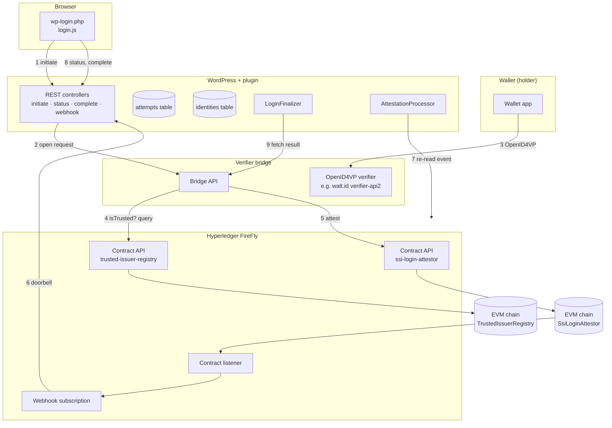

# Architecture

## Goals and non-goals

**Goals**
- Log a WordPress user in with a Verifiable Credential presented from a wallet, over a standard protocol.
- Make every login decision provable after the fact, without putting personal data on a ledger.
- Keep WordPress light: no credential parsing, no cryptographic keys, no long-running processes in PHP.
- Stay adaptable: the verifier, the event decoder and the user mapping are swappable.

**Non-goals**
- Being a wallet or an issuer.
- Replacing WordPress's password login. The credential block sits next to the password form.
- Requiring a blockchain for the protocol itself. The chain is the audit and event backbone and, with the
  trusted-issuer registry, the place where issuer trust is governed. It is not the cryptographic trust root of the
  credential: a credential's signature is checked against the issuer's own key, off chain.

## Components

| Layer | Component | Responsibility |
|---|---|---|
| Frontend | `LoginScreen`, `AssetManager`, `assets/js/login.js` | Injects the credential block on `wp-login.php`, renders the QR code and same-device link, polls, completes |
| Auth | `Rest\*Controller`, `BrowserBinding`, `LoginFinalizer` | Nonced, cookie-bound endpoints; programmatic login with `wp_set_current_user()` and `wp_set_auth_cookie()` |
| Session | `AttemptRepository`, `AttemptStatus` | Short-lived attempts in their own table, compare-and-set status changes |
| Identity | `IdentityRepository`, `UserResolver` | Maps a verified subject to a user: link-only by default, optional provisioning |
| Orchestration | `FireFlyClient`, `AttestationProcessor`, `EventReconciler`, `ContractEventDecoder` | Consumes FireFly events (push, with a pull fallback), confirms them, applies them |
| Verification | `VerifierClient` (`BridgeClient`) | Asks the sidecar to open a request and, later, for the verified subject |
| Chain | `contracts/SsiLoginAttestor.sol`, `contracts/TrustedIssuerRegistry.sol` | Append-only `LoginAttested` events from authorised verifiers; the owner-governed list of trusted `(issuer, vct)` pairs that the bridge queries through FireFly before it attests |

## Where each decision lives

| Question | Answer | Record |
|---|---|---|
| Which protocol faces the wallet? | OpenID4VP 1.0, in the verifier sidecar, not in WordPress and not in FireFly | [ADR 0001](adr/0001-oid4vp-at-the-edge.md) |
| Where does transient login state live? | A custom indexed table, with an HttpOnly binding cookie | [ADR 0002](adr/0002-session-binding-custom-table.md) |
| How does WordPress hear about results? | FireFly webhook as a doorbell, re-read from FireFly, with polling as a fallback | [ADR 0003](adr/0003-event-consumption.md) |
| What does FireFly carry? | An on-chain `LoginAttested` event with commitments only | [ADR 0004](adr/0004-on-chain-attestation.md) |
| What is the bridge built with? | TypeScript on Node 22 with no runtime dependencies, next to walt.id verifier-api2 in its own container | [ADR 0005](adr/0005-bridge-stack.md) |
| Which issuers are trusted, for which credential types? | An owner-governed registry contract of `(issuer, vct)` pairs, read by the bridge through FireFly's query API before it attests; signatures, holder binding and revocation stay in the verifier | [ADR 0006](adr/0006-trusted-issuer-registry.md) |

## Data model

**Attempt** (`{prefix}bloclabs_ssi_attempts`), one row per login try, deleted after a day:

| Column | Purpose |
|---|---|
| `public_id` | 128-bit handle the browser uses. Useless without the binding cookie |
| `correlation_id` | 256-bit id shared with the verifier and emitted on chain. Never sent to the browser |
| `binding_hash` | SHA-256 of the browser's cookie secret |
| `nonce` | Offered to the verifier for the presentation's key binding |
| `blinding_secret` | 256-bit per-attempt secret shared with the bridge only. Blinds `subject_commitment`, so the chain cannot be searched for a holder. Never sent to the browser |
| `status` | `pending` → `verified` → `consumed`, or `rejected` / `expired` / `failed` |
| `verifier_ref` | The bridge's request id |
| `subject_commitment`, `presentation_hash` | Copied from the on-chain event; checked against the bridge's answer at completion |
| `firefly_event_id`, `tx_ref` | Audit trail back to FireFly and the chain |
| `ip_hash` | Keyed hash of the client (IPv4 address or IPv6 /64), for rate limiting only |

**Identity** (`{prefix}bloclabs_ssi_identities`): `subject_hash` = HMAC-SHA256(plugin key, subject id) → `user_id`,
plus a short display label and the issuer DID, retained for the life of the link/account. The key is the plugin's own (`bloclabs_ssi_subject_key`, or
`BLOCLABS_SSI_SUBJECT_KEY`), so rotating WordPress salts does not unlink every credential.

Under `auto_provision`, the sanitized `name` claim becomes the new WordPress account's `display_name`; without one, `given_name` and `family_name` do (joined, or the login when neither is disclosed), and those two also become the account's first and last name. These persist with that account. Other claims are fetched from the bridge at completion and dropped unless an extension stores them. Attempt rows are purged separately; their retention does not remove account or identity data.

## Trust boundaries

1. **Browser ↔ WordPress.** Public. Every browser call carries the login page nonce (a cross-site check) and the
   binding cookie (`__Host-`, HttpOnly, SameSite=Strict). Unknown and foreign attempts both answer 404.
2. **FireFly → WordPress.** The webhook is authenticated by a shared secret header (FireFly cannot sign webhooks)
   and optionally an IP allowlist. Its body is never trusted: the processor re-reads the event by id.
3. **WordPress → FireFly, WordPress → bridge.** Private network. FireFly core has no authentication of its own, so it
   must never be exposed publicly. An authenticating proxy is supported through an `Authorization` header setting.
4. **Bridge → chain.** Only addresses the contract owner authorised can emit `LoginAttested`. The contract listener
   is bound to the contract address, and the decoder independently checks the configured listener and `attestor_address` against the log emitter.
   With `FIREFLY_REGISTRY_API` set, the bridge also reads `TrustedIssuerRegistry.isTrusted(issuer, vct)` through
   FireFly's query API before it attests, and attests a rejection for an untrusted pair. The read is an `eth_call`,
   not a transaction. Only the registry's owner, an operator key that is never the bridge's signing key, can change
   the list, and every change is an `IssuerSet` event ([ADR 0006](adr/0006-trusted-issuer-registry.md)).
5. **Bridge's HTTP answer vs. its on-chain record.** At completion WordPress recomputes
   `sha256(correlation_id ":" blinding_secret ":" subject_id)` and compares the presentation hash. This binds the subject and presentation hash only. WordPress does not recompute that hash from the HTTP claims: the issuer and disclosed claims passed to hooks are unattested HTTP data. Extensions must trust the authenticated bridge for those fields, and must not treat them as separately proven on chain. With the registry on, what the chain proves about the issuer is only this: a `LoginAttested` with `result = 1` was emitted after the bridge found the credential's `(issuer, vct)` trusted; the issuer string itself is not on chain.

See [SECURITY-MODEL.md](SECURITY-MODEL.md) for threats and mitigations.

## Extension points

| Hook | Kind | Use |
|---|---|---|
| `bloclabs_ssi_verifier_client` | filter | Replace the bridge client with another `VerifierClient` |
| `bloclabs_ssi_event_decoder` | filter | Decode a different contract event or layout |
| `bloclabs_ssi_resolve_user` | filter | Last word on which user a subject becomes; an account provisioned for a login it refuses or redirects is removed again |
| `bloclabs_ssi_provision_user_data` | filter | Shape (or refuse) accounts created for new subjects |
| `bloclabs_ssi_allow_login` | filter | Veto a login after the credential checked out; anything but `true` refuses |
| `bloclabs_ssi_wallet_url_schemes` | filter | Allowed wallet URL schemes (default `openid4vp`, `https`) |
| `bloclabs_ssi_attempt_retention` | filter | Seconds to retain attempt rows (default one day); does not govern identity/account data |
| `bloclabs_ssi_client_ip` | filter | Visitor IP behind unusual proxies |
| `bloclabs_ssi_login_template` | filter | Replace the login block markup |
| `bloclabs_ssi_attested` | action | An attestation settled an attempt |
| `bloclabs_ssi_commitment_mismatch` | action | The bridge's answer contradicted the chain: alert on this |
| `bloclabs_ssi_undecodable_event` | action | An event from the attestor listener did not decode: contract and decoder disagree |
| `bloclabs_ssi_booted` | action | Add-ons get the composition root |

Every setting can be pinned in `wp-config.php` as `BLOCLABS_SSI_<KEY>`. Secrets (`WEBHOOK_SECRET`,
`FIREFLY_AUTH_HEADER`, `VERIFIER_AUTH_HEADER` and `SUBJECT_KEY`) should only be set that way. The settings option is
created with autoload off. `VERIFIER_AUTH_HEADER` is required: without it credential login stays unavailable.

## Deployment topologies

**A. Everything on one private network (recommended).** WordPress, FireFly and the bridge share a Docker network.
FireFly delivers webhooks to WordPress's internal address (`wp bloclabs-ssi subscribe --webhook-url=http://wordpress/...`),
and the webhook IP allowlist is that network's range. Only WordPress and the bridge's wallet-facing endpoints are
public.

**B. WordPress hosted elsewhere.** FireFly cannot reach WordPress. Set event delivery to *Polling only*: the status
endpoint asks FireFly for recent `LoginAttested` events, through one shared scan at a time, with a 3-second cooldown and a 30-second cooldown after transport failures. Each attempt is checked at most once every 15 seconds. WordPress still
needs to reach FireFly, through a VPN or an authenticating proxy.

**C. Long-lived listener.** A WP-CLI process holding a FireFly WebSocket was considered and deferred
([ADR 0003](adr/0003-event-consumption.md)). The event processor is shared, so it can be added later without
touching the rest.

## Verifiable agents

The flow does not assume a human. An agent with a wallet (a holder library and a key) can answer the same OpenID4VP
request without a browser, and the attestation trail shows which agent logged in where. The roadmap adds:

- a finalizer that returns an application token instead of setting a cookie, for agents;
- the on-chain trusted-issuer registry ([ADR 0006](adr/0006-trusted-issuer-registry.md)), so the issuers of agent
  credentials are governed in the same place logins are attested;
- links to emerging agent-identity work. [ERC-8004](https://eips.ethereum.org/EIPS/eip-8004) (Draft) lets an agent's
  registration list a DID. The DIF Trusted AI Agents WG, the W3C Agent Identity Registry CG and the OpenID AIIM CG
  are working in the same direction; none has a protocol to adopt yet.
