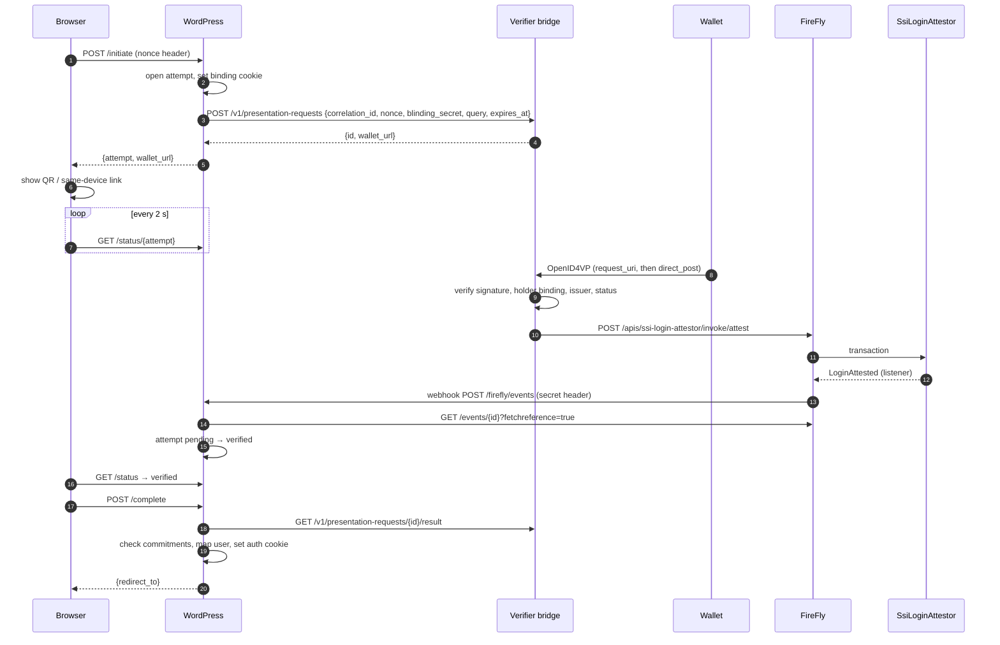

# FireFly flow

All paths are relative to `{firefly}/api/v1/namespaces/{ns}`. Payload shapes and timings below were captured on
FireFly v1.5.0 with a Besu QBFT chain (2-second blocks, `confirmations.required: 0`), running in gateway mode
(`multiparty.enabled: false`).

## Sequence



## One-time setup

Done once per environment by an operator (FireFly's own tooling, or `firefly-mcp`):

1. **Deploy the contract.** `POST /contracts/deploy?confirm=true`
   ```json
   {"contract": "0x<bytecode>", "definition": [<abi>], "input": ["<verifier signing address>"], "key": "<deployer>"}
   ```
   The answer's `output.contractLocation.address` is the contract address.
2. **Generate and register its interface.** `POST /contracts/interfaces/generate` with
   `{"name": "SsiLoginAttestor", "version": "1.0", "input": {"abi": [<abi>]}}`, then `POST /contracts/interfaces?confirm=true`
   with the result.
3. **Publish an API.** `POST /apis?confirm=true`
   `{"name": "ssi-login-attestor", "interface": {"id": "<interface id>"}, "location": {"address": "<contract>"}}`
4. **Create the listener.** `POST /apis/ssi-login-attestor/listeners/LoginAttested`
   `{"topic": "ssi-login", "options": {"firstEvent": "newest"}}`. FireFly requires the `topic`. Put the returned
   `id` in the plugin setting `firefly_listener_id`.
5. **Subscribe WordPress.** `wp bloclabs-ssi subscribe [--url=<internal url>]` creates:
   ```json
   {
     "name": "bloclabs-ssi-login",
     "transport": "webhooks",
     "filter": {"events": "blockchain_event_received", "blockchainevent": {"listener": "<listener id>"}},
     "options": {
       "firstEvent": "newest", "url": "<wordpress>/wp-json/bloclabs-ssi/v1/firefly/events", "method": "POST",
       "headers": {"X-Bloclabs-Ssi-Secret": "<secret>"},
       "fastack": false, "readAhead": 25,
       "retry": {"enabled": true, "count": 5, "initialDelay": "250ms", "maxDelay": "10s"}
     }
   }
   ```
   `fastack: false` makes FireFly wait for WordPress's 2xx before acknowledging, so a failed delivery is retried.
   `readAhead` lets independent deliveries run in parallel; WordPress is idempotent.

## Runtime calls

**Bridge → FireFly: attest.** `POST /apis/ssi-login-attestor/invoke/attest?confirm=true`
```json
{"key": "<verifier address>", "input": {
  "correlationId": "0x<64 hex>", "result": 1,
  "subjectCommitment": "0x<sha256(correlation_id ':' blinding_secret ':' subject_id)>",
  "presentationHash": "0x<sha256(presentation)>"},
 "idempotencyKey": "bloclabs-ssi-login:<correlation_id>"}
```
`result` is `1` (verified) or `2` (rejected). With `?confirm=true` the call returned in **2.9 s**, and the event was
already readable at that point. The `idempotencyKey` makes a retry safe: FireFly answers a repeated key with
`409` and `FF10431: Idempotency key '…' already used for transaction '<id>'`, and the bridge then reads
`GET /transactions/{id}/status` (`Succeeded`, `Pending` or `Failed`) instead of attesting again.

**FireFly → WordPress: delivery.** An enriched event. WordPress uses only its `id`, then re-reads the event (below). With `withData` off and no batching, the body is the event
itself (with `batch: true`, an array of them):
```json
{
  "id": "1f0e…", "sequence": 412, "type": "blockchain_event_received", "namespace": "default",
  "reference": "9c2b…", "topic": "ssi-login",
  "blockchainEvent": {
    "id": "9c2b…", "source": "ethereum", "name": "LoginAttested", "listener": "6d64577c-…",
    "output": {
      "correlationId": "0x3575e334…7fea", "result": "1",
      "subjectCommitment": "0x0b0a5c9c…89c4", "presentationHash": "0xced03b89…69f5",
      "verifier": "0xbf33f253…3abe"
    },
    "info": {"transactionHash": "0x…", "blockNumber": "…", "signature": "LoginAttested(bytes32,uint8,bytes32,bytes32,address)"}
  }
}
```
Note that FireFly renders `uint8` as a string (`"1"`). A captured event is in
[`tests/fixtures/firefly-login-attested.json`](../tests/fixtures/firefly-login-attested.json).

**WordPress → FireFly: confirm.** `GET /events/{id}?fetchreference=true` (singular `fetchreference` for one event;
the list endpoint takes `fetchreferences`). A 404 means the delivery named an event FireFly does not have: ignored.

**WordPress → FireFly: poll (fallback).**
`GET /blockchainevents?listener=<id>&name=LoginAttested&timestamp=>=<attempt start - 5s>&sort=-timestamp&limit=50&skip=<n>`,
page after page until a short page (at most 20 pages). FireFly filters take an operator prefix on the value (`>=`);
`-` before a sort field means descending. FireFly cannot filter on decoded output, so each page is decoded and
matched by `correlationId` in WordPress.

**Reorganisations.** A log the chain later drops arrives with `info.removed: true`; WordPress ignores it.

## What FireFly is, and is not, doing here

- **Is:** the gateway to the chain (signing, nonce management, resubmission), the indexer that turns logs into typed
  events, and the durable event stream with retries.
- **Is not:** a verifier. FireFly v1.5 has no W3C VC, DID-resolution or OpenID4VP support; its identities are
  `did:firefly` organisation and node identities for multiparty networks.
- **Not used:** FireFly broadcast and private messages. They need multiparty mode, are org-to-org (a phone wallet is
  not a FireFly member), and would put payloads in shared storage. A contract event carries only what must be public.

## Latency budget

| Step | Typical |
|---|---|
| Wallet → bridge verification | wallet-dependent, ~1 s |
| `attest` → event in FireFly | 2–3 s (one 2 s block, no extra confirmations on QBFT) |
| Webhook → WordPress → status poll | ≤ 2 s (poll interval) |
| **Wallet tap → logged in** | **~4–6 s** |

On chains without instant finality, raise `confirmations.required` in evmconnect and expect a longer wait.
